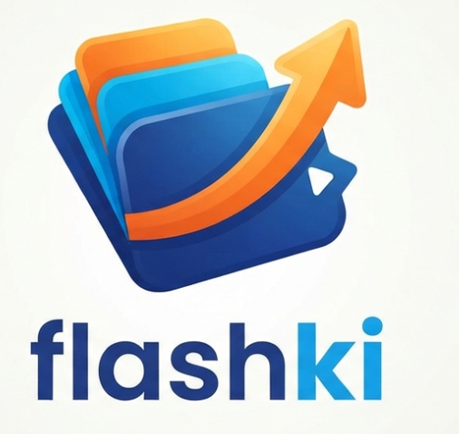

# Flashki — Smart Flashcards & Interactive Stories (Tauri 2 + SQLite)

<p align="center">
  <a href="https://7amzalam.github.io/flashki/">
    
  </a>
</p>

<p align="center">
  <a href="https://7amzalam.github.io/flashki/">
    
  </a>
</p>


A complete open-source desktop app for language learning and vocabulary memorization built on **Spaced Repetition (SM-2)**, plus **AI-powered interactive stories (Google Gemini)** — with 100% safe and fast local storage via a **SQLite** database and high-quality natural text-to-speech through **Edge TTS**.

---

## 🌟 Key Features

### 1. Smart Spaced Repetition Algorithm (SM-2)
- Precise, science-based scheduling of word reviews driven by memory response (buttons: *Again / Hard / Good / Easy*).
- Support for cards with image backgrounds, with elegant cinematic dimming and a word-highlight layer.
- Per-card voice recording to practice pronunciation and listening.
- Support for the Common European Framework levels (CEFR: A1, A2, B1, B2, C1, C2) to organize learning.

### 2. Standalone Interactive Stories Reader
- Generate engaging interactive stories around any topic or vocabulary the learner picks, at the right level.
- **Three-layer reading system:**
  1. Story text in the target language (with full LTR alignment that prevents punctuation drift).
  2. Parallel (interlinear) translation shown directly under each sentence.
  3. Key vocabulary extracted automatically below the story.
- **Turn any word into a card instantly:** clicking any word in the story opens an interactive popup to hear its pronunciation, view its meaning and contextual example, and save it immediately as a card under the story's deck — with verbs reverted to the infinitive and nouns to their definite articles (der/die/das).
- Sequential audio reader through a smart sentence queue supporting Google TTS and Microsoft Edge TTS.

### 3. AI-Powered Automatic Card Generation (Gemini AI)
- Turn any text or article into complete flashcards with a single click.
- Extract contextual examples in the target language, translated directly into your native language.
- Pick the right deck, or automatically create a new one titled from the text's context.

### 4. Full Deck & Word Management
- A dedicated window to edit the words, sentences and images of each deck.
- Automatic image compression using Canvas, cutting file size by over 90% while keeping excellent clarity.
- Instant option to create a new deck right from inside the quick-input form.

### 5. Full Support for 8 Global Languages (Multi-Language UI)
- A bidirectional interface (RTL & LTR) 100% translated into:
  - 🇸🇦 Arabic
  - 🇺🇸 English
  - 🇩🇪 German
  - 🇫🇷 French
  - 🇪🇸 Spanish
  - 🇹🇷 Turkish
  - 🇮🇷 Persian
  - 🇵🇰 Urdu

### 6. Blazing-Fast Local Storage & Performance
- A real **SQLite** database (WAL mode) that keeps data safe and corruption-free, backed by a **sql.js WASM** engine when previewing in the browser.
- Export and import JSON backups, including all voice recordings and images.
- Focus mode: hide the sidebar with one click for total focus on reading and reviewing.

---

## 🛠️ Architecture

| Layer | Technology |
|---|---|
| **Frontend** | Vanilla JavaScript (ES6+), HTML5, modern CSS variables (no heavy bundlers) |
| **Storage Engine** | SQLite 3 via `tauri-plugin-sql` (local `flashki.db` file) with automatic `sql.js WASM` fallback |
| **Desktop Shell** | Tauri 2 (Rust core) — very lightweight, low RAM usage, high security |
| **AI Core** | Google Gemini API (2.5 Flash / Flash Lite / Pro) via secure calls from the app core |
| **TTS Engine** | High-quality Microsoft Edge TTS + local Web Speech API + Google TTS fallback |
| **Review Algorithm** | SM-2 Spaced Repetition Algorithm |

---

## 🚀 Installation & Running (Developers)

### Prerequisites:
1. **Node.js**: version 20 or higher (LTS) from [nodejs.org](https://nodejs.org).
2. **Rust & Cargo**: from [rustup.rs](https://rustup.rs).
3. **System tools (Linux):**
   ```bash
   sudo apt update
   sudo apt install -y build-essential curl wget file libx11-dev libasound2-dev \
     libwebkit2gtk-4.1-dev libgtk-3-dev libayatana-appindicator3-dev librsvg2-dev
   ```

### 1. Run the app in desktop development mode:
```bash
# Install dependencies
npm install

# Run the app through Tauri in a desktop window
npm run dev
```

### 2. Run the quick web preview in a browser:
```bash
npm run web
# Open your browser at: http://localhost:5173
```

### 3. Build the distributable production version:
```bash
npm run build
```
This produces ready-to-distribute installer packages at:
- **Windows:** `src-tauri/target/release/bundle/nsis/*.exe` or `.msi`
- **Linux:** `src-tauri/target/release/bundle/deb/*.deb` or `.AppImage`
- **macOS:** `src-tauri/target/release/bundle/dmg/*.dmg`

---

## 🔑 Enabling AI (Gemini)

1. Get a free key from [Google AI Studio](https://aistudio.google.com/apikey).
2. Open the app and go to: **Settings → AI Engine**.
3. Paste the key and press **Save & Test Connection**.
4. The key is encrypted and stored **locally on your device only**, never shared with any external server.

---

## 📁 Project Structure

```text
flashki-main/
├── src/                      # Frontend (HTML / CSS / JavaScript)
│   ├── index.html            # Screen structure and templates
│   ├── css/
│   │   └── styles.css        # Styles, dark/light theme system, and RTL/LTR layout
│   ├── js/
│   │   ├── app.js            # App lifecycle and review-session management
│   │   ├── db.js             # Unified SQLite database layer
│   │   ├── store.js          # Interface for cards, decks and reviews
│   │   ├── srs.js            # SM-2 spaced repetition scheduling algorithm
│   │   ├── ai.js             # Text processing, card & story generation with Gemini
│   │   ├── tts.js            # Text-to-speech engines (Edge TTS / Google)
│   │   ├── audio.js          # Voice recorder and microphone handling
│   │   ├── render.js         # Rendering engine and UI updates
│   │   ├── handlers.js       # Event and input handling, image compression
│   │   ├── i18n.js           # Internationalization and auto-translation system
│   │   └── util.js           # Helpers, Canvas compression, and level calculation
│   └── i18n/                 # The eight translation files (405 keys per language)
│       ├── ar.json / en.json / de.json / fr.json
│       └── es.json / tr.json / fa.json / ur.json
├── src-tauri/                # Desktop app core (Rust + Tauri 2)
│   ├── src/
│   │   ├── main.rs           # Entry point
│   │   └── lib.rs            # Rust functions: image saving, Gemini calls, and Edge TTS
│   ├── Cargo.toml            # Rust packages and configuration
│   └── tauri.conf.json       # Window, packaging and permissions settings
└── package.json
```

---

## 🗺️ Roadmap

| Platform | Status | Notes |
|---|---|---|
| 🪟 Windows | ✅ Available (msi / nsis) | Via the GitHub Releases page |
| 🐧 Linux | ✅ Available (deb / rpm / AppImage) | Via the GitHub Releases page |
| 🤖 Android | 🔜 **Coming soon, in shaa Allah** | Tauri 2 officially supports Android — the port is in preparation as a future update |
| 🍎 iOS / macOS | ⏳ Not scheduled for now | Requires building exclusively on a Mac |

---

## 📄 License

This project is licensed under the [MIT License](LICENSE).
All rights reserved to the developers and the open-source community.
